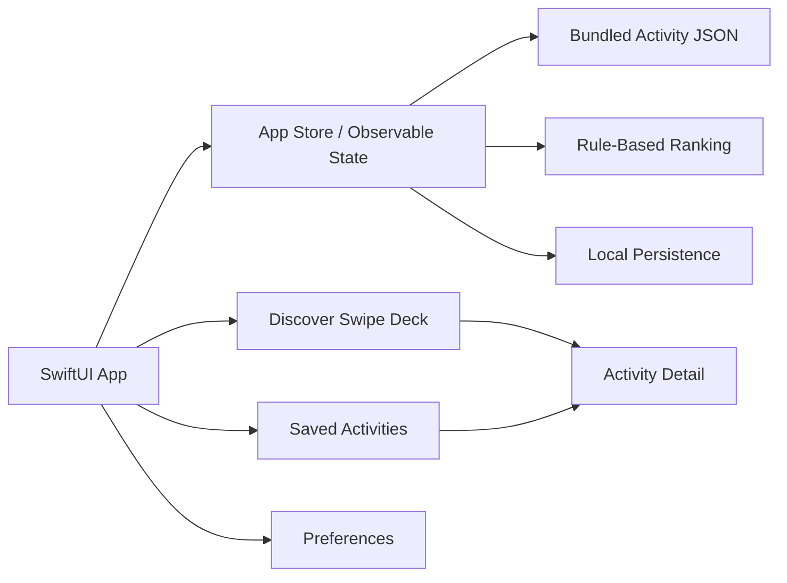

# Endless Activity

Native iOS app plan for a Tinder-style endless scroller for activities. The product helps people who are bored quickly find something realistic to do, save ideas, and tune the feed around time, cost, energy, setting, and mood.

The repo is currently in planning-first mode. App implementation should follow the roadmap and docs in this repository instead of re-deriving product decisions.

## Current Status

Roadmap phase: Phase 2 SwiftUI app scaffold in progress. The project scaffold exists; simulator build verification remains blocked because full Xcode is not installed or discoverable on this machine.

Created planning artifacts:
- [Agent instructions](AGENTS.md)
- [Workspace plan](EndlessActivityWorkspacePlan.md)
- [Markdown docs plan](EndlessActivityMarkdownDocsPlan.md)
- [Master execution roadmap](docs/MASTER_EXECUTION_ROADMAP.md)
- [Codex skills routing](docs/CODEX_SKILLS.md)
- Product, architecture, data, ranking, design, privacy, testing, demo, and case-study docs under [docs](docs)

Do not start Phase 3 until the Phase 2 simulator build gate passes with full Xcode selected. Keep the Phase 1 product, brand, schema, and catalog decisions fixed unless the roadmap is updated first.

Created app scaffold:
- `EndlessActivity.xcodeproj`
- `EndlessActivity/App/EndlessActivityApp.swift`
- Native Discover, Saved, and Preferences tab placeholders
- Asset catalog placeholder
- XCTest and XCUITest targets

## Product Direction

Final working name: Endless Activity.

One sentence: Endless Activity is a native iOS swipe deck for finding something realistic to do when you are bored.

MVP boundary:
- Solo user experience.
- Native SwiftUI.
- Curated bundled activity catalog.
- Local persistence.
- Swipe right to save.
- Swipe left to skip.
- No account, backend, monetization, social planning, live event APIs, or required location permission in v1.

## Planned Stack

- SwiftUI for app UI.
- Swift 6 or current stable Xcode Swift toolchain.
- iOS 17+ target unless the implementation phase changes this.
- Local bundled JSON for the activity catalog.
- Codable models for catalog decoding.
- SwiftData or lightweight file/UserDefaults persistence, chosen during Phase 2 based on scaffold needs.
- XCTest for unit tests.
- XCUITest for golden-path interaction tests.

## Codex Skills

This repo includes local Codex skills in [.agents/skills](.agents/skills). Future agents should use them as documented in [docs/CODEX_SKILLS.md](docs/CODEX_SKILLS.md).

Available skills:
- `brandkit`
- `design-taste-frontend`
- `gpt-taste`
- `imagegen-frontend-mobile`
- `imagegen-frontend-web`

Default routing:
- Brand identity and case-study visuals: `brandkit`.
- Native iOS visual references: `imagegen-frontend-mobile`.
- App layout and polish review: `design-taste-frontend`.
- High-intensity marketing/case-study page direction: `gpt-taste`.
- Website or portfolio landing-page references: `imagegen-frontend-web`.

## Source Of Truth

Read these before implementation:

1. [Master execution roadmap](docs/MASTER_EXECUTION_ROADMAP.md)
2. [Codex skills routing](docs/CODEX_SKILLS.md)
3. [Workspace plan](EndlessActivityWorkspacePlan.md)
4. [Product spec](docs/PRODUCT_SPEC.md)
5. [Implementation plan](docs/IMPLEMENTATION_PLAN.md)
6. Relevant subsystem docs in [docs](docs)

## Documentation Map

- [Product spec](docs/PRODUCT_SPEC.md)
- [Implementation plan](docs/IMPLEMENTATION_PLAN.md)
- [Master roadmap](docs/MASTER_EXECUTION_ROADMAP.md)
- [Codex skills](docs/CODEX_SKILLS.md)
- [Architecture](docs/ARCHITECTURE.md)
- [Data model](docs/DATA_MODEL.md)
- [Activity catalog guide](docs/ACTIVITY_CATALOG_GUIDE.md)
- [Ranking and personalization](docs/RANKING_AND_PERSONALIZATION.md)
- [Design system](docs/DESIGN_SYSTEM.md)
- [Brand and media](docs/BRAND_AND_MEDIA.md)
- [Privacy and safety](docs/PRIVACY_AND_SAFETY.md)
- [Testing strategy](docs/TESTING_STRATEGY.md)
- [Environment](docs/ENVIRONMENT.md)
- [Demo walkthrough](docs/DEMO_WALKTHROUGH.md)
- [Portfolio case study](docs/PORTFOLIO_CASE_STUDY.md)
- [Unfinished surfaces audit](docs/UNFINISHED_SURFACES_AUDIT.md)

## Architecture At A Glance



## Local Development

Open `EndlessActivity.xcodeproj` in Xcode and run the `EndlessActivity` scheme.

Command-line build after full Xcode is selected:

```bash
xcodebuild -project EndlessActivity.xcodeproj -scheme EndlessActivity -destination 'platform=iOS Simulator,name=iPhone 16' build
xcodebuild -project EndlessActivity.xcodeproj -scheme EndlessActivity -destination 'platform=iOS Simulator,name=iPhone 16' test
```

Current local blocker verified on 2026-06-26: this machine has Command Line Tools selected and no full Xcode app is discoverable, so `xcodebuild` and `simctl` cannot run here yet.

## Demo Path

The v1 demo should show:

1. Launch app into Discover.
2. Swipe right on an appealing activity.
3. Verify it appears in Saved.
4. Swipe left on an activity.
5. Open Preferences and apply a filter.
6. Return to Discover and see a changed deck.
7. Open a detail screen with steps, materials, duration, and cost.
8. Relaunch and confirm saved activities and preferences persist.

## Non-Goals

- No social graph in v1.
- No group voting in v1.
- No activity booking or marketplace in v1.
- No AI-generated activity feed in v1.
- No live local event integrations in v1.
- No required location permission in v1.
- No backend or account system in v1.
