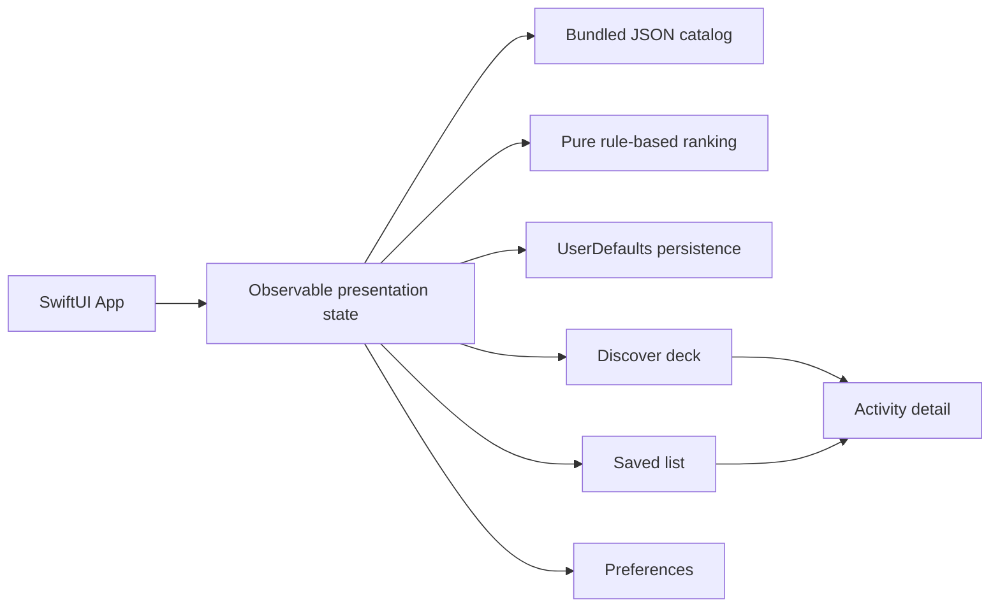
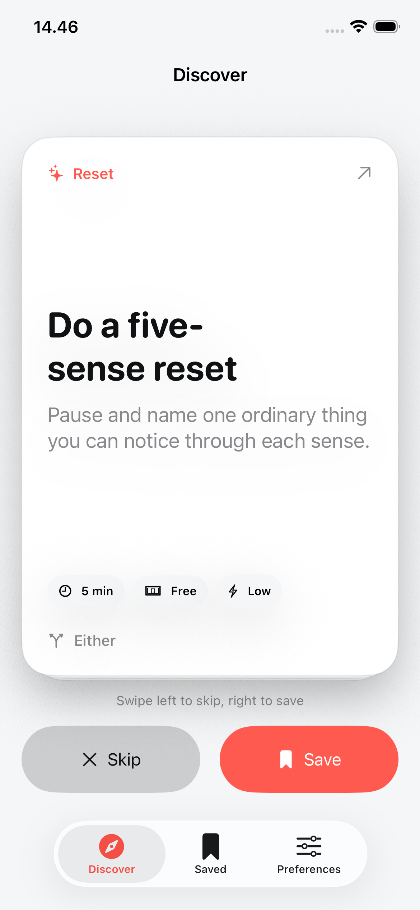

# Endless Activity

Endless Activity is a native iOS swipe deck for finding something realistic to
do when you are bored. Swipe right to save an idea, swipe left to skip it, and
use practical filters for time, cost, energy, setting, company, and category.

## Current status

Roadmap Phases 0 through 6 are complete. The MVP is local-first, offline after
install, and intentionally focused on solo discovery with a bundled catalog.

- 50 validated activities with deterministic rule-based ranking.
- Local saved, skipped, completed, and preference state.
- Discover deck with swipe gestures, haptics, detail sheets, and empty states.
- Saved list with removal and native detail presentation.
- Preferences with persistent filters and confirmed history reset.
- VoiceOver actions, button alternatives, Reduce Motion, and large text paths.
- 12 unit tests, 7 UI tests, four simulator screenshots, and a 24-second demo.

The last full simulator verification passed on 2026-06-28 with Xcode 26.6 on
iPhone 17e and iPhone 17 Pro Max. A fresh simulator run requires full Xcode.

## Product workflow

1. Launch directly into Discover.
2. Swipe right to save or left to skip.
3. Tap a card for materials, steps, and safety guidance.
4. Adjust practical filters in Preferences.
5. Open Saved and relaunch to confirm local state persists.

## Architecture



Implementation is split across Codable models, catalog loading, ranking,
persistence, and SwiftUI presentation state. The deck owns presentation order;
the source catalog remains unchanged.

## Verification

Full Xcode verification command:

```bash
xcodebuild -project EndlessActivity.xcodeproj -scheme EndlessActivity -destination 'platform=iOS Simulator,name=iPhone 17e,OS=26.5' test
```

Large-device build:

```bash
xcodebuild -project EndlessActivity.xcodeproj -scheme EndlessActivity -destination 'platform=iOS Simulator,name=iPhone 17 Pro Max,OS=26.5' build
```

The repository also supports static catalog checks and Swift typechecking of
the model/service layer without Xcode.

## Screens and demo



[Activity detail](docs/assets/phase-6/screenshots/02-activity-detail.png) ·
[Saved](docs/assets/phase-6/screenshots/03-saved.png) ·
[Preferences](docs/assets/phase-6/screenshots/04-preferences.png)

[Download the 24-second screen walkthrough](docs/assets/phase-6/endless-activity-demo.mp4)

The walkthrough uses real iPhone 17e simulator captures for Discover, detail,
Saved, and Preferences. It documents the implemented save, filter, and local
persistence states without implying an unimplemented backend or live feed.

## Scope

The v1 deliberately excludes accounts, backend sync, required location,
social planning, live events, booking, payments, marketplaces, analytics, and
AI-generated activities.

## Documentation

Start with the [Master Execution Roadmap](docs/MASTER_EXECUTION_ROADMAP.md),
then read the [Codex skills routing](docs/CODEX_SKILLS.md),
[Workspace Plan](EndlessActivityWorkspacePlan.md), [Product Spec](docs/PRODUCT_SPEC.md),
and [Implementation Plan](docs/IMPLEMENTATION_PLAN.md).

Additional references:

- [Architecture](docs/ARCHITECTURE.md)
- [Data Model](docs/DATA_MODEL.md)
- [Activity Catalog Guide](docs/ACTIVITY_CATALOG_GUIDE.md)
- [Ranking and Personalization](docs/RANKING_AND_PERSONALIZATION.md)
- [Design System](docs/DESIGN_SYSTEM.md)
- [Brand and Media](docs/BRAND_AND_MEDIA.md)
- [Privacy and Safety](docs/PRIVACY_AND_SAFETY.md)
- [Testing Strategy](docs/TESTING_STRATEGY.md)
- [Environment](docs/ENVIRONMENT.md)
- [Demo Walkthrough](docs/DEMO_WALKTHROUGH.md)
- [Portfolio Case Study](docs/PORTFOLIO_CASE_STUDY.md)
- [Unfinished Surfaces Audit](docs/UNFINISHED_SURFACES_AUDIT.md)
