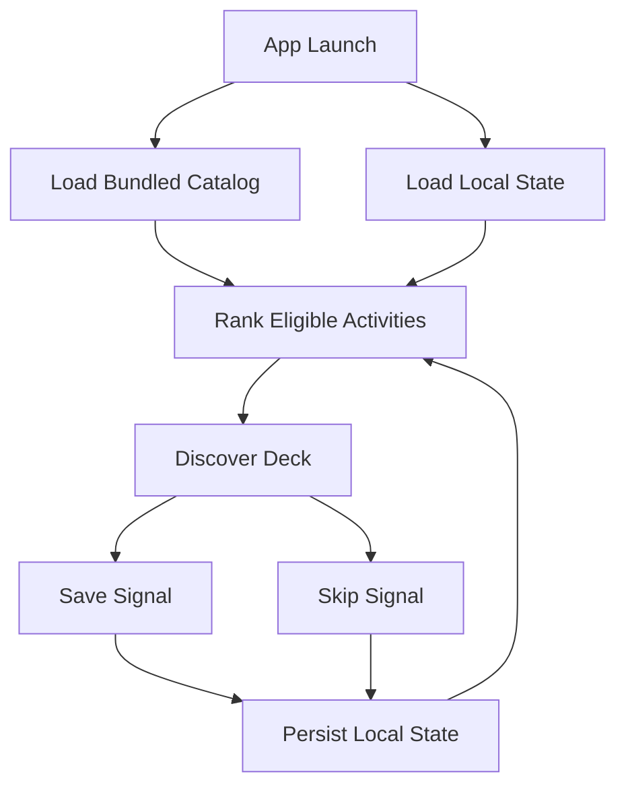

# Architecture

## Summary

Endless Activity should use a small native architecture: SwiftUI views, testable services, local state, bundled data, and local persistence.

## Layers

Presentation:
- SwiftUI views.
- Native tab navigation.
- Swipe gestures.
- Detail sheets.
- Accessibility labels and actions.

State:
- Observable app state or view models.
- Discover deck state.
- Saved list state.
- Preferences state.

Domain:
- Activity models.
- Filtering logic.
- Ranking logic.
- Signal handling.

Data:
- Bundled JSON catalog.
- Local persistence for saved/skipped IDs and preferences.

## Core Data Flow

## Module Boundaries

Catalog loader:
- Owns decoding bundled JSON.
- Does not own ranking.
- Does not mutate activities.

Persistence service:
- Owns saved IDs, skipped IDs, preferences, and optional completed IDs.
- Does not own card layout.

Ranking service:
- Pure Swift logic.
- Input: catalog, preferences, user signals.
- Output: ordered activity IDs or activities.
- No SwiftUI dependency.

Views:
- Render state.
- Send user actions.
- Avoid embedding ranking rules.

## Suggested Types

- `Activity`
- `ActivityCategory`
- `ActivityCostLevel`
- `ActivityEnergyLevel`
- `ActivitySetting`
- `ActivitySocialMode`
- `ActivityPreferences`
- `UserActivitySignal`
- `ActivityCatalogLoader`
- `ActivityPersistenceStore`
- `ActivityRankingService`
- `DiscoverViewModel`
- `SavedViewModel`
- `PreferencesViewModel`

## Persistence Choice

Default to the simplest reliable approach during implementation:

- Use `UserDefaults` for small primitive preference and ID sets.
- Use a local JSON file if signals need richer records.
- Use SwiftData only if the implementation benefits from queries or a more structured local store.

Do not add a backend or cloud sync in v1.

## Error Handling

Catalog decode failure:
- In debug, fail loudly.
- In release, show a friendly unrecoverable state.

Persistence failure:
- Keep current in-memory state.
- Show no blocking alert unless user action cannot be completed.

Empty deck:
- Offer reset history.
- Offer relax filters.

## Accessibility

Gestures must have button alternatives:
- Save.
- Skip.
- Open details.
- Reset filters.

Cards need VoiceOver labels that summarize the activity without reading every tag.
