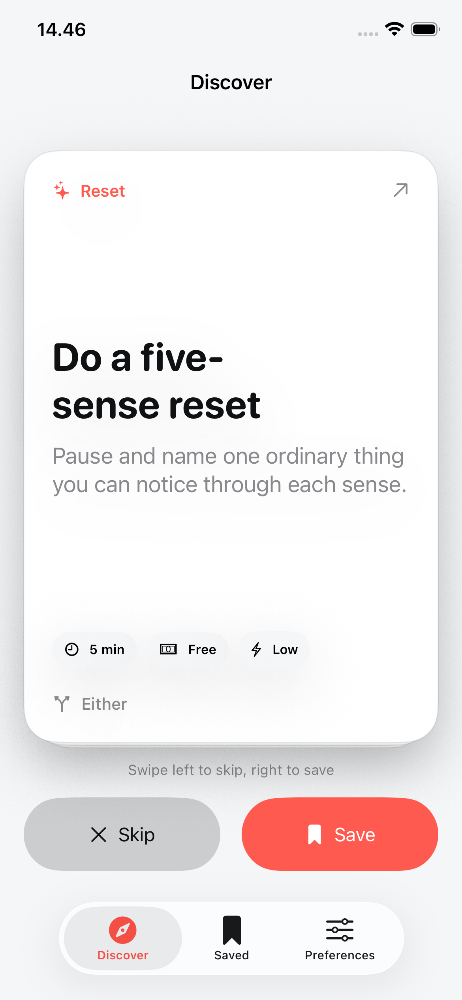
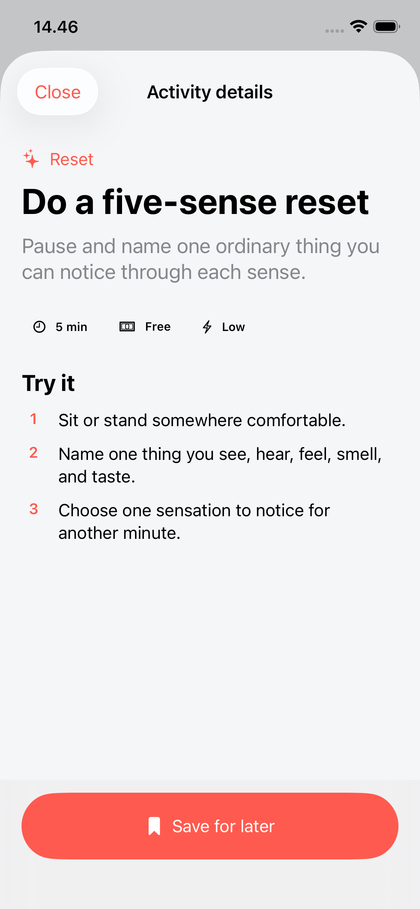
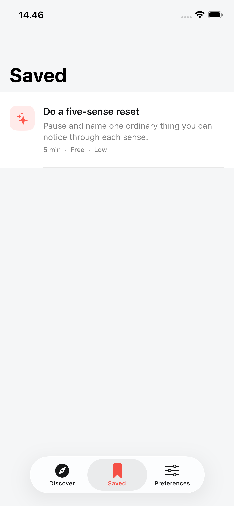
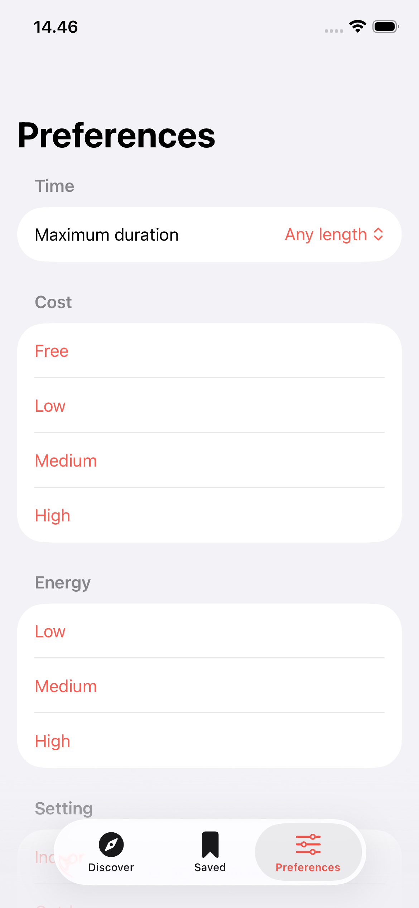
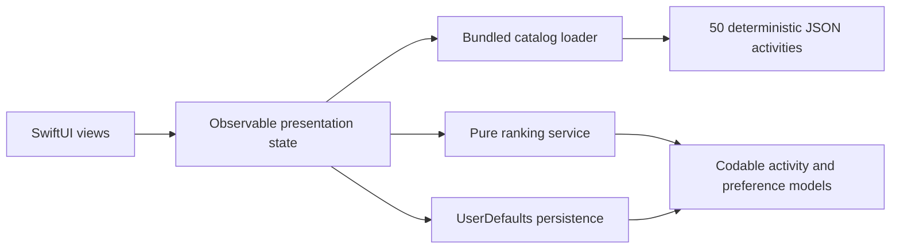

# Portfolio Case Study

## Title

Endless Activity: A Native iOS Swipe Deck For Finding Something To Do

## Summary

Endless Activity is a native iOS MVP that turns boredom into a simple discovery loop. Users swipe through curated activity ideas, save what sounds good, skip what does not, and tune the feed by practical constraints like time, cost, energy, and setting.

## Problem

When people are bored, they often do not have a clear search query. Existing options are either too broad, too social, too location-dependent, or too heavy for a quick moment of indecision.

## Product Decision

The MVP avoids accounts, location, AI generation, and live events. That keeps the first version fast, private, offline-capable, and focused on validating the interaction loop.

## Core Experience

- Discover card appears on launch.
- Swipe right saves.
- Swipe left skips.
- Preferences shape the deck.
- Saved list turns browsing into action.

## Implemented Screens

| Discover | Activity detail |
| --- | --- |
|  |  |

| Saved | Preferences |
| --- | --- |
|  |  |

## Technical Decisions

- SwiftUI for native interaction.
- Bundled JSON catalog for deterministic content.
- Local persistence for saved/skipped/preferences.
- Rule-based ranking for transparent behavior.
- XCTest and XCUITest for core loop coverage.

## Architecture

The swipe deck owns presentation order while the source catalog remains immutable. Ranking is isolated from SwiftUI, and persistence stores only user signals and practical filters.

## Codex Skill Usage

The repo uses local Codex skills:

- `brandkit` for brand and case-study presentation.
- `imagegen-frontend-mobile` for native mobile screen direction.
- `design-taste-frontend` for UI polish review.
- `gpt-taste` only for high-end portfolio page direction if needed.
- `imagegen-frontend-web` only if a web case-study page is built.

## Tradeoffs

Chosen:
- local-first
- curated catalog
- solo MVP
- simple ranking

Deferred:
- social planning
- live events
- AI generation
- backend
- location-aware recommendations
- monetization

Implementation tradeoffs:
- UserDefaults is sufficient for a compact local signal set, but it is not positioned as a future sync layer.
- The seeded rule-based ranker is explainable and testable, but intentionally avoids behavioral ML.
- Bundled JSON makes launches deterministic and offline, at the cost of requiring an app update for new catalog content.
- Native controls and sheets reduce custom visual freedom, but improve platform familiarity, Dynamic Type behavior, and VoiceOver semantics.

## Verification

The final Phase 6 run on 2026-06-28 passed 12 unit tests and 7 UI tests on iPhone 17e with iOS 26.5. The UI suite covers launch, details, Save/Skip controls, direct left/right swipes, Saved removal, Preferences reset, relaunch persistence, and screenshot capture. An iPhone 17 Pro Max build also passed.

Accessibility implementation includes card summaries, named Save/Skip/detail actions, visible alternatives to gestures, Reduce Motion handling, scrollable accessibility-size Discover content, and standard native control semantics. Physical haptic feel and spoken VoiceOver quality remain manual pre-submission checks.

## What The Project Demonstrates

- Product scoping.
- Native iOS interaction design.
- Gesture-driven UX.
- Local data modeling.
- Testable ranking logic.
- Documentation discipline.
- AI-agent workflow design with repo-local skills.

## Final Case Study Checklist

- [x] Real implementation screenshots.
- [x] Architecture diagram from implemented code.
- [x] Final test results.
- [x] Final app icon.
- [x] Implementation-specific tradeoffs.

[Recorded 24-second screen walkthrough](assets/phase-6/endless-activity-demo.mp4) is
included as a lightweight presentation artifact. A separate portfolio landing
page remains optional.
