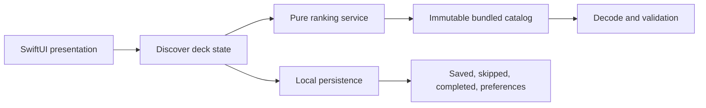

# Portfolio Case Study

## Endless Activity

### A Native iOS Product That Turns Boredom Into One Realistic Choice

## Portfolio Role

Endless Activity is a supporting case study for product-focused frontend and
product-engineering roles. It complements larger systems work with a compact
example of native interaction craft, deterministic state, accessibility, and
disciplined product scope.

It should not compete with the flagship case studies. Its job is to prove that
small consumer products still benefit from explicit architecture, honest
boundaries, and release evidence.

## Story In One Sentence

I designed and built a local-first SwiftUI activity deck that helps someone move
from an unfocused moment of boredom to one practical idea without onboarding,
an account, location permission, network access, or generated content.

## The Product Problem

Search assumes the user already knows what they want. Boredom is the opposite
state: the user wants to do something but cannot form a useful query.

The product needed to reduce that decision to a lightweight loop:

1. Show one realistic activity immediately.
2. Let the user save or skip without interpretation.
3. Offer practical filters when context matters.
4. Keep useful ideas available after relaunch.

The risk was not technical complexity. The risk was turning a small idea into a
social platform, event marketplace, location product, or AI wrapper before the
core interaction had earned that expansion.

## The Scope Decision

Version one deliberately uses:

- a curated 50-item bundled catalog;
- deterministic rule-based ranking;
- local persistence;
- a solo-first interaction model;
- native SwiftUI navigation, sheets, controls, gestures, and accessibility.

Version one deliberately excludes:

- accounts and cloud sync;
- required location;
- social planning and group voting;
- live events, vendors, booking, and payments;
- AI-generated activities and behavioral recommendation models.

This restraint made the product fast, private, testable, and complete enough to
evaluate as an interaction-led MVP.

## My Role

Independent product direction, native iOS UX, SwiftUI implementation, catalog
and ranking architecture, local persistence, accessibility behavior, testing,
documentation, and portfolio release preparation.

## The Core Experience

### Discover

The app launches directly into a stacked card deck. Right swipe saves, left
swipe skips, and visible buttons provide equivalent actions. A partial gesture
springs back instead of committing accidentally.

### Details

The card stays concise. A native sheet adds materials, steps, and safety
guidance only when the user asks for depth.

### Saved

Saved activities become a short, durable list rather than another feed. The
user can reopen details or remove an activity using native list behavior.

### Preferences

Filters represent practical constraints: time, cost, energy, setting, company,
and category. Reset Filters preserves history; destructive history reset keeps
filters and requires confirmation.

## Architecture

The boundaries are intentional:

- the catalog loader owns decoding and validation;
- the ranking service is pure Swift with no UI dependency;
- persistence owns small local signals and preferences;
- the deck owns presentation order without mutating source activities;
- views render state and send actions rather than embedding ranking rules.

## Engineering Decisions

### The Deck Owns Presentation, Not Source Data

Save and skip remove an activity from the active deck, while the 50-item catalog
remains unchanged. The experience can be rebuilt from catalog, preferences, and
persisted signals without repairing mutated content.

### Deterministic Ranking Before Opaque Personalization

Eligibility filters run before scoring. Saved categories and overlapping tags
provide transparent boosts. A seeded stable tie-break makes ordering varied but
reproducible in tests.

### Local Persistence Is Enough For Version One

Saved, skipped, completed, and preference state fit in one Codable UserDefaults
payload. This keeps the version-one loop offline and avoids positioning a small
state store as a future sync architecture.

### A Gesture Never Becomes A Gate

Save and Skip are visible controls and named VoiceOver actions. The current card
is one concise accessibility element, background cards are removed from focus,
accessibility-size layouts scroll, and Reduce Motion bypasses swipe-off motion.

### Recovery Is Part Of The Empty State

An exhausted deck explains why it is empty and offers the relevant recovery:
relax filters or restore skipped ideas. Saved activities remain protected.

## Verification Evidence

The final full simulator run on 28 June 2026 recorded:

- 12 passing unit tests;
- 7 passing UI tests;
- a passing iPhone 17e test destination;
- a passing iPhone 17 Pro Max build;
- swipe-left and swipe-right coverage;
- details, Saved removal, Preferences reset, and relaunch persistence coverage;
- four current simulator screenshots;
- a 24-second walkthrough assembled from the verified captures.

The 50-item catalog has 50 unique IDs and 50 unique titles. Structural checks
cover required fields, ID format, title and summary limits, tags, step counts,
and concrete content quality.

## What The Work Proves

- Product judgment: the MVP solves one moment without expanding into a platform.
- Interaction craft: gesture feedback, visible alternatives, haptics, details,
  and recovery form one coherent native loop.
- Frontend architecture: catalog, ranking, persistence, and presentation state
  remain independently understandable and testable.
- Accessibility: equivalent actions and adaptive layouts are product behavior,
  not a final annotation pass.
- Release discipline: claims are tied to tests, captures, documentation, and
  explicit limitations.

## Tradeoffs

- Bundled JSON makes launches deterministic and offline, but catalog updates
  require an app release.
- UserDefaults is appropriate for compact local state, but it is not a cloud
  synchronization strategy.
- Rule-based ranking is inspectable and testable, but intentionally avoids
  behavioral learning.
- Native controls reduce visual novelty in some surfaces, but improve platform
  familiarity, Dynamic Type behavior, and VoiceOver semantics.

## Limitations

- The latest full simulator verification is dated 28 June 2026. The 4 August
  audit environment has Swift tooling but no full Xcode installation for a
  fresh simulator rerun.
- The project is not an App Store release and makes no claim about retention,
  recommendation quality, or real-world usage.
- Physical haptic feel and spoken VoiceOver quality remain manual device checks
  before any distribution claim.
- The 24-second artifact is a presentation walkthrough assembled from verified
  captures, not a continuous live interaction recording.

## Case Study Media

| Discover | Activity detail |
| --- | --- |
|  |  |

| Saved | Preferences |
| --- | --- |
|  |  |

[Watch the 24-second walkthrough](assets/phase-6/endless-activity-demo.mp4).

## Interview Talk Track

"Endless Activity is a small native iOS product, so I treated scope as the main
engineering decision. The app opens directly into one realistic idea, uses
accessible save and skip interactions, and keeps ranking and persistence local
and deterministic. The interesting part is not the number of screens; it is how
the catalog, ranking, deck state, recovery behavior, and tests make a playful
gesture trustworthy. I stopped before accounts, location, live events, or AI
generation because none of those were needed to prove the version-one loop."
